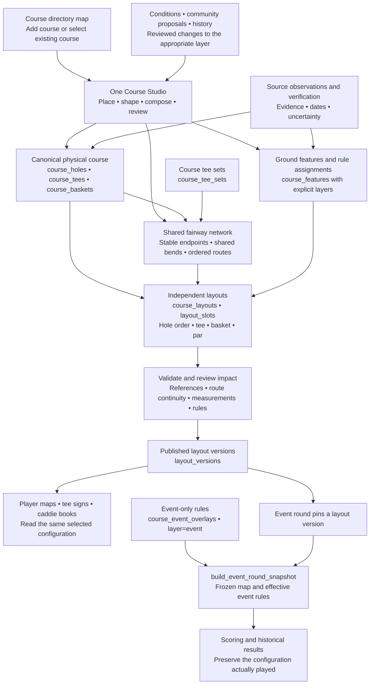
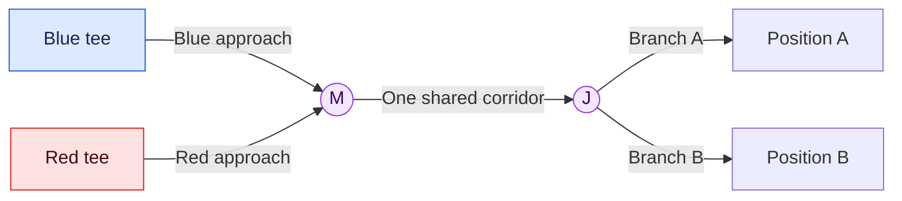

# Course Builder Design Reference

Course Studio should maintain one geographic course model that supports reusable fairways, independent playable layouts, event configurations, signs, caddie books, and course operations. Accurate physical mapping and reliable shared routes come first; survey tools, operations, and advanced 3D extend that foundation.

This reference adapts the supplied [Course Research and Implementation Brief](references/Disc_Golf_Dashboard_Course_Research_and_Implementation_Brief.md), version 1.0 dated October 9, 2026, to the existing project. It accompanies [the canonical model](canonical-model.md), [the Course Studio design](master-phase-course-studio-3.md), and the course module guidance. The source brief is preserved unchanged for its detailed research, diagrams, data dictionary, and acceptance scenarios.

The brief is research and target-capability material. Its embedded Codex prompts, suggested migrations, technology choices, and approval procedures do not independently authorize implementation, deployment, production writes, or additional tasks. This reference records the requested design direction; current user instructions and applicable AGENTS.md rules govern implementation.

## Course architecture diagram



The diagram combines existing canonical structures with the target workflow. It does not assert that every consumer already resolves every route field or that all publication checks are implemented. Those integrations need verification before changes use them.

Current changes, validation evidence, and outstanding database gates are tracked in [Course Builder Implementation Progress](course-builder-implementation-progress.md).

Physical assets belong to the course. Layouts select and order those assets; copying a layout copies its slots rather than creating another physical course. Labels and tee colors are presentation, while stable asset IDs identify relationships. Basket positions must remain distinct from the future equipment-and-placement history described in the brief.

## Shared fairway diagram



If all four pairings are assigned, Blue→A, Blue→B, Red→A, and Red→B reference the same M→J section. Render that section once with interleaved dotted tee colors. Editing a shared bend updates its dependent routes together. Each route counts the shared section once in its own distance. Deleting one pairing retains the sections used by surviving pairings.

Routes retain their selected, ordered control-point identities. A shortest-path calculation must not substitute a different playing route. Saved manual splits remain separate after reload. Tee-to-basket assignments decide which pairings are available; the example does not require every tee to play every basket on every hole. Optional basket-to-basket connections retain basket identities and do not create tees.

The current implementation represents the graph through shared point IDs and ordered routes in versioned JSON; unique edges are derived from adjacent point IDs. The brief's proposed fairway-node/edge/route tables are conceptual options, not a requirement to replace this storage.

## Builder workflow and screen structure

```text
Course directory map → select or add course → same Course Studio

Course → Map → Layouts → Signs and Caddie Book → Review and Publish

┌──────────────────────────────────────────────────────────────────┐
│ Course / layout / hole          Save state         Undo / Redo   │
├──────────┬───────────────────────────────────┬───────────────────┤
│ Map tools│                                   │ Selected item     │
│          │        Primary map workspace      │ Names and colors  │
│ Place    │                                   │ Routes / rules    │
│ Shape    │ Tees → shared fairways → positions │ Par and distances │
│ Connect  │                                   │ Evidence / quality│
├──────────┴───────────────────────────────────┴───────────────────┤
│ Contextual next action / validation issue / affected layouts     │
└──────────────────────────────────────────────────────────────────┘
```

Keep the map central and expose advanced properties for the selected object. On phones, collapse tools and properties so placement and dragging remain usable. Completion indicators guide the next action without preventing unfinished physical features from being mapped.

1. **Locate and establish the course.** Use the directory map entry point. Display the course location quality and keep basemap alignment separate from feature coordinates.
2. **Map physical assets.** Place all relevant tees and basket positions on the course, name them, assign course-wide tee sets, and retain stable IDs through saves.
3. **Shape and connect routes.** Select intended tee/basket pairings, edit bends, join approaches, share sections, and create persistent splits. Show route length from the same rounded geometry displayed on the map.
4. **Compose independent layouts.** Choose physical assets and hole order, set the selected configuration's par, and retain explicit distance overrides. Alternate pairing metadata must not silently replace a layout's selected scoring configuration.
5. **Describe ground and assign rules.** Map woods, water, paths, obstacles, and amenities separately from penalties. Apply rule scope through existing layer and layout-rule behavior. Event-only rules stay in Event Director's overlay on the same editor.
6. **Review and publish.** Present actionable issues and affected configurations. Publication preserves an earlier version; scored rounds keep their resolved configuration. Future events adopt a newer version deliberately.

## Existing implementation anchors

These are source entry points in the current workspace, not claims of production readiness or a completed audit.

| Concern | Existing anchor | How the brief attaches |
|---|---|---|
| One editor | `src/routes/_authenticated/courses.$courseId.studio.tsx` and `courses.$courseId.edit.tsx` both load `src/components/pages/courses-new-page.tsx` | Extend the shared CourseBuilder instead of making another placement map |
| Route topology | `src/lib/course-builder/pairing-fairways.ts` | Shared interior points, explicit ordered routes, insertion, movement, and pruning |
| Existing persistence | `src/lib/course-builder/studio-fairways.ts` | Adapt legacy data and version-1 JSON in `hole_tees.flight_path` and `hole_baskets.split_point`; preserve primary `holes.flight_path` compatibility |
| Route editing | `src/components/course-builder/studio-fairway-editor.tsx` | Reuse map selection, undo, and save flows |
| Shared display | `src/components/course-builder/studio-pair-paths.tsx` | Derive unique shared edges and participating tee colors |
| Curves and joins | `src/lib/course-builder/fairway-curves.ts` and `automatic-fairways.ts` | Display and distance use the same sampled curve; stored data retains editable controls |
| Pair scoring | `src/lib/course-builder/pair-scoring.ts` and `studio-fairways.ts` | Keep par and explicit measured-distance overrides associated with endpoint IDs |
| Save preservation | `src/lib/course-builder/save-safety.ts` and `src/components/pages/courses-new-page.tsx` | Complete reads before writes, validate hole coverage, preserve IDs, retain recovery drafts, upsert replacements before explicit removals |
| Layout composition | `src/components/course-builder/layout-studio/layout-studio-page.tsx` and `src/lib/course-builder/layouts.ts` | Physical asset selection through `layout_slots`; publish to `layout_versions` |
| Rules and layers | `src/lib/course-builder/layers.ts` and `layout-rules.ts` | Preserve base/layout/event/condition separation and effective layout selection |
| Imported geometry | `src/lib/course-geometry/harvest.server.ts` | Stage source coordinates in `course_geometry_observations`; fill empty spots without overwriting steward geometry |
| Event history | `drizzle/migrations/0038_event_chain_layout_versions.sql`, `0039_event_snapshot_merge.sql`, and `docs/canonical-model.md` | Preserve version pins and `build_event_round_snapshot` rather than introducing a parallel event snapshot system |
| Signs | `src/components/tee-signs/pro-sign.tsx` and `src/lib/tee-sign-pro.ts` | Extend the common renderer with selected route and rule data |

Also consult [Studio pair fairways](studio-pair-fairways.md) and [the route network milestone](canonical-route-network-milestone-1.md). The older `route-network.ts` resolver has separate compatibility and integration gates; adopting the research brief does not authorize replacing the active Studio resolver with it.

## Reconciliation with project behavior

| Brief proposal | Project rule or existing behavior | Design decision |
|---|---|---|
| Proximity only offers a join; crossings never connect automatically | Course module guidance records the October 8 approval of automatic joins within six feet for new/default routes in the same hole, including nearby crossings | Preserve automatic joins, the drag preview, the off switch, and saved manual splits. Adapt brief scenarios G05/G12 to distinguish preview, newly generated routes, and saved routes |
| Separate persisted fairway graph entities | Studio already persists shared identities and per-pair paths in version-1 JSON | Extend existing adapters first; require evidence of a storage limitation before proposing graph tables |
| Internal meters and candidate PostGIS calculations | Current route APIs measure feet; the app already uses Leaflet | Keep compatible APIs and the existing renderer. Define explicit unit/coordinate boundaries before a measured migration; do not swap stacks solely to match the brief |
| New generic course/version/snapshot entities | Canonical course assets, layout versions, and event snapshots already define the chain | Attach new evidence and history to that chain instead of creating a Course V2 database |
| Generic rule precedence | Existing layer rules and `layoutPlaysFeature` define course behavior; event rules are isolated | Extend the established resolver deliberately and test conflicts; do not add a competing inheritance algorithm |

## Measurement and evidence requirements

Keep direct distance, intended-route distance, official published distance, terrain distance, net elevation, and any effective-length estimate distinct. Store the origin and approval of an official distance; disagreement with a computed route creates a review issue rather than moving accurate geometry to match a sign. Define a repeatable tee throwing-edge measurement point separately from its icon center.

Ground elevation, object height, and flight modeling represent different things. Missing terrain samples or uncertainty remain unknown. A complete map is not automatically a surveyed map. Course map coverage stays on the existing `course_map_coverage_rows` definition; survey confidence is a separate dimension.

Future survey capture should retain observation dates, method, original coordinates and coordinate system, normalized coordinates, horizontal/vertical uncertainty, datum, evidence, and verification authority. Imported imagery retains its own alignment transform. Existing source snapshots and geometry observations remain auditable. The brief's source register supplies research starting points; verify current standards and provider terms when implementing those capabilities.

## Implementation sequence

| Stage | Scope | Completion evidence |
|---|---|---|
| 1 — Preserve and verify | Existing load/save, mobile gestures, stable identities, draft recovery, curve-distance agreement, permissions, and snapshot boundaries | Create/edit/save/reload and failure/retry preserve assets and shapes; existing layouts and old rounds remain readable |
| 2 — Complete shared routes | Course tee sets, assigned multi-pin routes, shared stretches, joins, independent splits, deletion, undo/redo, and per-pair metadata | One shared corridor without duplicate remnants; surviving routes retain continuity; saved manual splits persist |
| 3 — Align layouts and consumers | Selected route/par/distance, scoped rules, event overlays, signs, caddie books, publication impact | Consumers show the same selected configuration; completed and active rounds keep their pinned configuration |
| 4 — Add field evidence | Throwing-edge capture, survey import, coordinate/datum handling, elevation profiles, offline evidence, verification | Traceable measurements with explicit unknowns and no changes to verified coordinates from imagery alignment |
| 5 — Extend operations | Inspections, work orders, dated equipment placements, closures, reviewed physical revisions | A maintenance change updates the appropriate layer/version while preserving prior rounds |
| 6 — Add advanced views | Optional 3D terrain and vegetation, design alternatives, modeled analysis | Measurable practical value with observed geometry distinguished from assumptions |

The first implementation task should verify the existing two-tee/two-position shared-corridor flow across editing, rendering, serialization, and reload, then fix the smallest demonstrated discrepancy. The supplied brief does not establish a new duplicate-route bug in the current workspace. Before a schema change, trace the affected layouts, published versions, event snapshots, scoring, imports, and rating dependencies.

## Acceptance checklist

Use the brief's Appendix B as the detailed scenario inventory, with the join-policy adaptation above. These are acceptance requirements, not reported test results.

- [ ] Blue and Red tees can play their assigned A/B positions through one shared corridor; excluded pairings stay excluded.
- [ ] A shared bend updates every dependent route; adding a junction splits the reused edge consistently.
- [ ] Shared sections render once with participating colors, plus identifiable labels/patterns.
- [ ] Split, detach, delete, undo/redo, save/reload, and save retries retain valid memberships and stable endpoint identities.
- [ ] New/default nearby joins follow the six-foot project rule. Snap preview and disabling automatic joining work; persisted manual splits survive reload.
- [ ] Curved display and measured route length agree. Distance overrides retain their meaning, and missing alternate par stays unset.
- [ ] Switching layouts changes selected assets/order/par/rules without making another physical course or altering its physical hole count.
- [ ] Imagery alignment leaves feature coordinates unchanged; unknown accuracy and missing terrain remain unknown.
- [ ] Ordinary woods/water geometry produces no penalty without an applicable rule assignment; event-only rules stay out of everyday views.
- [ ] Publishing and later basket moves do not silently change completed or in-progress round configurations. Snapshot coverage includes every newly consumed route/scoring field.
- [ ] Incomplete loads disable writes, failed saves retain recovery data, retries avoid duplicates, and removal targets only explicitly removed loaded IDs.
- [ ] Protected edits remain governed by existing database permissions, community review, and audit history.

Historical correction, ordinary physical modification, temporary condition, and event-rule change remain distinct operations. Additive changes should retain legacy read compatibility, use copied fixtures for conversion tests, and support rollback through adapters or version selection. Course-builder work must preserve imports and rating behavior.
